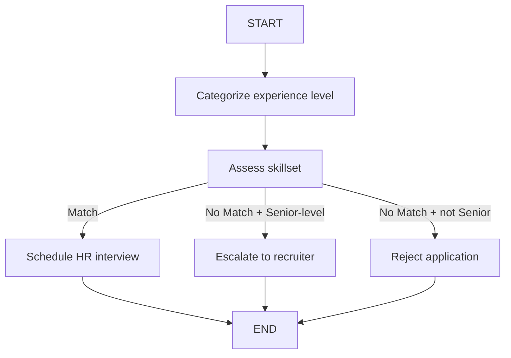

# Recruiter Agent (LangGraph)

An AI-powered candidate screening workflow built with **LangGraph** and **LangChain**. It reads a job application, classifies the candidate's experience level, checks their skills against a Python Developer role, and routes them to the right outcome automatically.

## How it works



1. **categorize_experience**: the LLM labels the candidate as Entry-level, Mid-level or Senior-level.
2. **assess_skillset**: the LLM answers `Match` or `No Match` for a Python Developer role.
3. **route_app** (conditional edge) decides the outcome:
   - Skills match → HR interview is scheduled
   - Skills don't match but the candidate is senior → escalated to a human recruiter
   - Otherwise → application rejected

Shared state passed between nodes: `application`, `experience_level`, `skill_match`, `response`.

## Tech stack

- Python
- LangGraph (state graph and conditional routing)
- LangChain (prompt templates, chains)
- OpenAI (`ChatOpenAI`)
- Google Colab (development environment)

## Setup

1. Open the notebook/script in Google Colab.
2. Add your OpenAI key in Colab **Secrets** with the name `openAiKey`.
3. Run all cells. Dependencies are installed with:
```
   pip install langchain langchain_core langchain_community langgraph langchain_openai
```

## Usage

```python
result = run_candidate_screening(
    "I have experience in software engineering with expertise in Python"
)
print(result)
# {'experience_level': ..., 'skill_match': ..., 'response': ...}
```

## Example inputs tried

| Application text | Purpose of test |
|---|---|
| 10 years of experience, expertise in Java | Senior, skills mismatch → escalation path |
| 1 year of experience, expertise in Java | Junior, skills mismatch → rejection path |
| Software engineering experience, expertise in Python | Skills match → interview path |
| 5 years of experience, expertise in C++ | Mid-level, skills mismatch → rejection path |

Outputs come from an LLM, so exact labels can vary between runs.

## Future improvements

- Accept the job description as input instead of a fixed Python Developer role
- Parse resumes from PDF files
- Return structured output (JSON / Pydantic) instead of free text
- Send real emails and calendar invites for the interview and rejection steps
- Wrap it in a FastAPI endpoint with a database for storing screening results

## Author

S. Udayeswar Reddy
